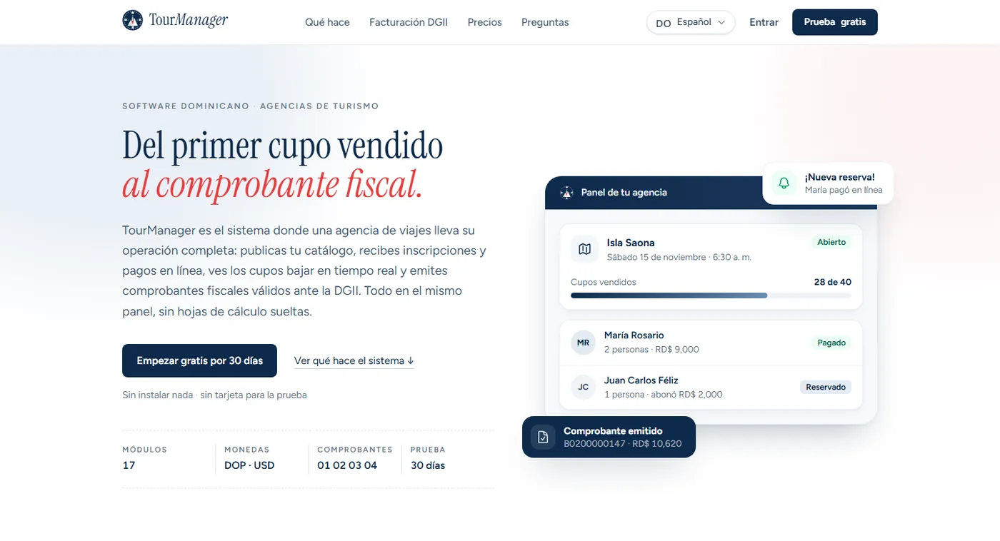
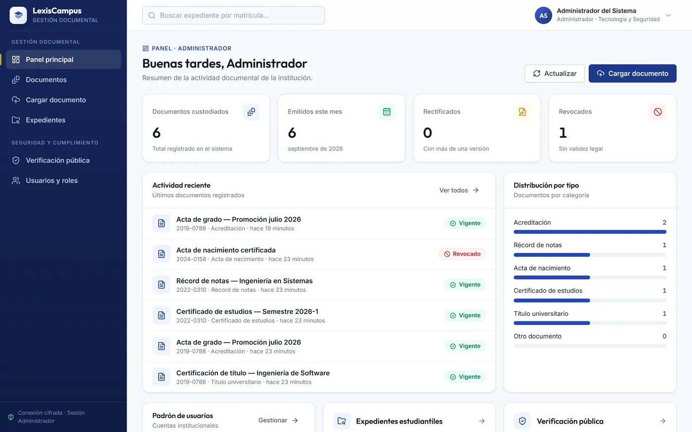

  

  

  Soy <b>Keisy Duran</b>, desarrolladora de software en Santo Domingo. 
  Este es el código de mi portafolio: lo diseñé y lo programé desde cero, sin plantillas.

 

## ✨ Lo que vas a encontrar

- **Cuatro sombreros, un mismo sistema.** Lo que he hecho como backend, frontend, QA e infraestructura, con ejemplos reales de cada proyecto.
- **Mis proyectos, con su caso completo.** Tour Manager y el Sistema de Inventario de Servidores están en producción; también LexisCampus DMS, Próspera, el módulo de solicitudes del SGA y un punto de venta.
- **Mi trayectoria.** De instalar redes a administrar servidores y construir los sistemas que corren sobre ellos.

<table>
  <tr>
    <td width="50%">
<b>Tour Manager</b> · en producción
</td>
    <td width="50%">
<b>LexisCampus DMS</b> · pasantía
</td>
  </tr>
</table>

## 🎨 Cómo está hecho

Quise que el sitio se sintiera mío, no como una plantilla más:

- **Identidad propia:** paleta de arena, coral y ciruela, con tipografías Fraunces, Plus Jakarta Sans y JetBrains Mono. Tiene tema claro y oscuro.
- **Una pila animada** con las cuatro capas en las que trabajo (interfaz, API, datos y servidor), por donde viaja una petición hasta responder `200 OK`.
- **Interactivo:** texto que se escribe solo, contadores, filtros de proyectos por rol, ventanas con galería para cada caso y animaciones al hacer scroll.
- **Accesible y adaptable:** funciona en el celular, se puede usar con teclado y respeta a quien prefiere menos movimiento.

  
  
  
  

Sin frameworks ni dependencias: HTML, CSS y JavaScript puros.

## 📬 Hablemos

  
  
  

  

